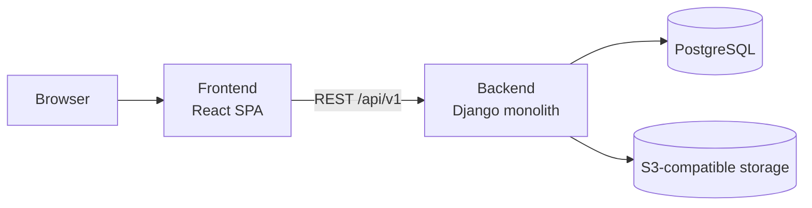

# Gymeri
> A platform for finding gyms and personal trainers in your city. Launching in Lutsk, Ukraine.
 
## About
 
Gymeri helps people choose where and with whom to train. It brings together three groups of users:
 
- **Clients** browse gyms and chains, compare prices, and contact trainers.
- **Trainers** publish a profile and receive requests from clients.
- **Gyms and chains** maintain pages with addresses, prices, and contacts.
Core features: a catalog of gyms with prices and map locations, trainer profiles with search and filters, client requests to trainers, an exercise library with technique guides, and role-based accounts.
 
## Architecture
 
The system is a **modular monolith**: a single Django backend, a single-page frontend, and one PostgreSQL database. The backend is deployed as one unit. Its internal modules are Django apps with clear boundaries, so an app can be extracted into a separate service later if needed.
 

 
### Backend apps
 
| App | Responsibility |
|---|---|
| `accounts` | Registration, login, roles |
| `gyms` | Gyms, chains, price options |
| `trainers` | Trainer profiles and specializations |
| `requests` | Client requests to trainers |
| `exercises` | Exercise library |
 
Apps communicate through their services, not by reaching into each other's models and tables.
 
### Layers
 
Each app follows the same layering:
 
```
views / serializers  ->  services  ->  models (ORM)  ->  database
```
 
- **Views and serializers** handle HTTP, validation, and serialization, and delegate to services.
- **Services** contain business logic and access rules.
- **Models** describe the data and simple entity rules.
Business logic does not live in views. This keeps it testable and reusable.
 
## Tech stack
 
| Layer | Technology |
|---|---|
| Backend | Python 3.11+, Django, Django REST Framework |
| Database | PostgreSQL, Django migrations |
| Frontend | React, TypeScript, Vite |
| Testing and quality | pytest, pytest-django, ruff |
| CI | GitHub Actions |
| Hosting | Vercel (frontend), Render (backend), Neon (database) |
 
## Repository structure
 
```
.
├── backend/
│   ├── config/           # settings, urls, wsgi/asgi
│   ├── apps/
│   │   ├── accounts/
│   │   ├── gyms/
│   │   ├── trainers/
│   │   ├── requests/
│   │   └── exercises/    # each app: models, services, serializers,
│   │                     # views, urls, migrations/, tests/
│   └── manage.py
├── frontend/             # React + TypeScript SPA
├── .env.example
└── README.md
```
 
## Getting started
 
Requirements: Python 3.11+, Node.js 20+, PostgreSQL.
 
```bash
cp .env.example .env              # set DATABASE_URL and secrets
cd backend
python -m venv .venv && source .venv/bin/activate
pip install -r requirements.txt
python manage.py migrate
python manage.py createsuperuser
python manage.py runserver
```
 
The Django admin is available at `/admin/` and is used to manage the catalog of gyms and trainers.
 
Frontend instructions will be added as the code lands.
 
## Database migrations
 
Models are the source of truth. Migrations are generated from them, numbered per app, and committed to the repository.
 
```bash
python manage.py makemigrations   # creates 0001_initial.py, 0002_..., ...
python manage.py migrate          # applies them
```
 
Migration files live in each app's `migrations/` folder. Review generated files before committing, and do not edit migrations that have already been applied.
 
## Contributing
 
1. Create a branch from `main`.
2. Keep changes focused; add or update tests.
3. Make sure lint and tests pass.
4. Open a pull request.
## License
 
TBD
 
