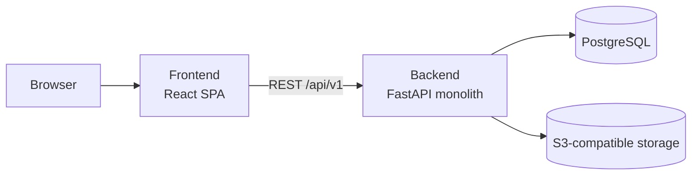

# Gymeri
 
> A platform for finding gyms and personal trainers in your city. Launching in Lutsk, Ukraine.
 
## About
 
Gymeri helps people choose where and with whom to train. It brings together three groups of users:
 
- **Clients** browse gyms and chains, compare prices, and contact trainers.
- **Trainers** publish a profile and receive requests from clients.
- **Gyms and chains** maintain pages with addresses, prices, and contacts.
Core features: a catalog of gyms with prices and map locations, trainer profiles with search and filters, client requests to trainers, an exercise library with technique guides, and role-based accounts.
 
## Architecture
 
The system is a **modular monolith**: a single backend service, a single-page frontend, and one PostgreSQL database. The backend is deployed as one unit, and its internal modules have clear boundaries, so a module can be extracted into a separate service later if needed.
 

 
### Backend modules
 
| Module | Responsibility |
|---|---|
| `auth` | Registration, login, tokens, roles |
| `users` | User profiles, client and trainer relations |
| `gyms` | Gyms, chains, price options |
| `trainers` | Trainer profiles and specializations |
| `requests` | Client requests to trainers |
| `exercises` | Exercise library |
 
Modules communicate through their services, never through each other's database tables.
 
### Layers
 
Each module follows the same layering:
 
```
router  ->  service  ->  repository  ->  database
              |
           domain (framework-free)
```
 
- **Routers** handle HTTP and delegate to services.
- **Services** contain business logic and access rules.
- **Repositories** hide data access behind abstractions.
- **Domain** holds entities and rules with no dependency on the framework or the database.
Services depend on abstractions (repositories, file storage, notifiers), not on concrete implementations. This keeps the domain testable in isolation and makes infrastructure replaceable.
 
## Tech stack
 
| Layer | Technology |
|---|---|
| Backend | Python 3.11+, FastAPI, SQLAlchemy 2 |
| Database | PostgreSQL, Alembic migrations |
| Frontend | React, TypeScript, Vite |
| Testing and quality | pytest, ruff, mypy |
| CI | GitHub Actions |
| Hosting | Vercel (frontend), Render (backend), Neon (database) |
 
## Repository structure
 
```
.
├── backend/              # FastAPI application
│   ├── app/              # domain, services, repositories, API
│   ├── migrations/       # Alembic
│   └── tests/
├── frontend/             # React + TypeScript SPA
├── .env.example
└── README.md
```
 
## Getting started
 
Requirements: Python 3.11+, Node.js 20+, PostgreSQL.
 
```bash
cp .env.example .env          # set DATABASE_URL and secrets
cd backend
alembic upgrade head          # apply migrations
```
 
Run instructions for the backend and frontend will be added as the code lands.
 
## Database migrations
 
```bash
alembic revision --autogenerate -m "describe change"
alembic upgrade head
```
 
Review generated migrations before applying them. Do not edit applied migrations; create a new one instead.
 
## Contributing
 
1. Create a branch from `main`.
2. Keep changes focused; add or update tests.
3. Make sure lint, type checks, and tests pass.
4. Open a pull request.
## License
 
TBD
 
